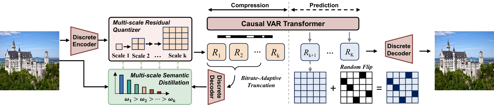
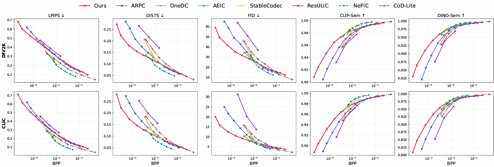
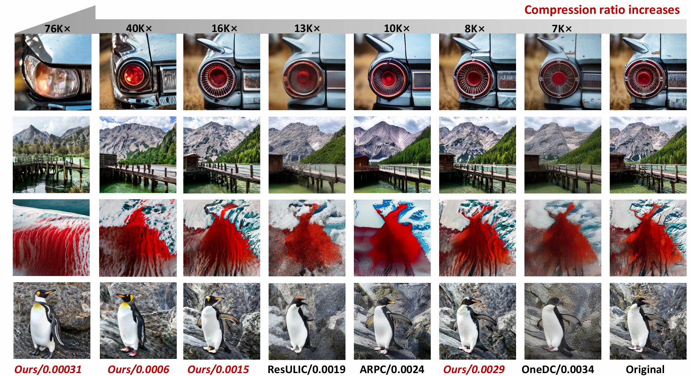

<h1 align="center">Hierarchical Visual Description Learning for Ultra-low Rate Progressive Image Compression</h1>

<p align="center">
  Hanfei&nbsp;Li &ensp; <b>&middot;</b> &ensp;
  Anle&nbsp;Ke &ensp; <b>&middot;</b> &ensp;
  Junqi&nbsp;Shi &ensp; <b>&middot;</b> &ensp;
  Tong&nbsp;Chen &ensp; <b>&middot;</b> &ensp;
  Zhan&nbsp;Ma
</p>

<p align="center">
  Nanjing University
</p>


<p align="left">
  <strong>We propose a VAR-based framework for ultra-low-rate progressive image compression with enhanced semantic preservation and reconstruction quality.</strong>
</p>


<p align="center">
  
</p>

## 📢 News
- **2026.10.14** — Our paper has been accepted by **IEEE JETCAS**!


## 📊 Quantitative Results

We evaluate our method on DIV2K and CLIC in terms of LPIPS, DISTS, FID, CLIP-Sem, and DINO-Sem across different bitrates.

<p align="center">
  
</p>

## 🖼️ Visual Comparisons

Visual comparisons at extremely low bitrates. Our method preserves plausible visual structures and semantic content at compression ratios up to 76,000×.

<p align="center">
  
</p>


## 🌊 TODO
- [x] Release quantitative results
- [ ] Release inference code
- [ ] Release pretrained models
- [ ] Release training code

## ❤ Acknowledgement

This work builds upon [Infinity](https://github.com/FoundationVision/Infinity). We thank the authors for their valuable contributions.

## 🙇 Citation

If you find our work useful, please consider citing:

```bibtex
@article{Li2026Hierarchical,
    author  = {Li, Hanfei and Ke, Anle and Shi, Junqi and Chen, Tong and Ma, Zhan},
    title   = {Hierarchical Visual Description Learning for Ultra-low Rate Progressive Image Compression},
    journal = {IEEE Journal on Emerging and Selected Topics in Circuits and Systems},
    year    = {2026},
    note    = {Accepted for publication}
}
```
